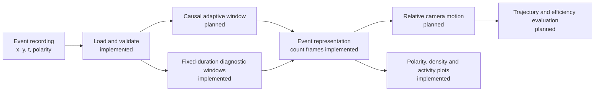
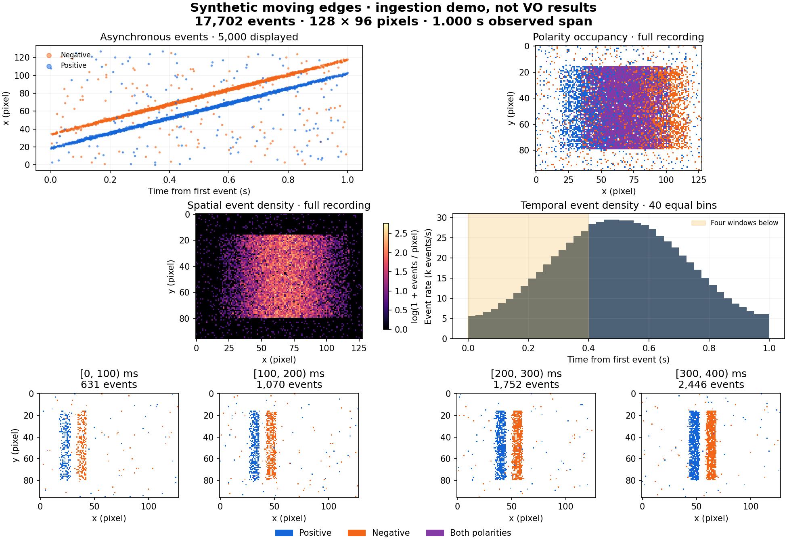

# Adaptive Event VO

**Research question:** Can a causal event-window controller use recent event density and motion activity to improve the accuracy–computation trade-off of monocular event-based visual odometry?

This repository is a small research framework under development. **Week 1 is implemented:** validated event ingestion, fixed-duration visualization windows, count-based event frames, a deterministic synthetic demo, and automated tests. Motion estimation, adaptive control, visual odometry, and trajectory evaluation are planned. No VO performance improvement has been established.

## System architecture



The working path is **recording → validation → event frames → diagnostic figure and JSON**. The proposed controller and VO stages have no placeholder implementations.

## Quick start

Requires Python 3.10+; the reference run used Python 3.12.14, NumPy 2.3.5 and Matplotlib 3.10.8. No GPU, display server, or downloaded dataset is needed.

```bash
git clone https://github.com/aryaaupa/adaptive-event-vo.git
cd adaptive-event-vo
python -m venv .venv
source .venv/bin/activate
python -m pip install -e .
adaptive-event-vo demo --output-dir outputs/demo
```

The demo generates a seeded synthetic recording, **reloads it through the dataset loader**, and writes:

- `outputs/demo/synthetic_events.npz`: named event arrays, integer microsecond timestamps.
- `outputs/demo/event_stream.png`: asynchronous event raster, polarity occupancy, spatial density, temporal rate, and four adjacent accumulation windows.
- `outputs/demo/event_stream.json`: event counts, window bounds, input SHA-256, command, seed, and runtime versions.

Equivalent commands are `python -m adaptive_event_vo demo` and `python scripts/run_demo.py`. Run the tests with:

```bash
python -m unittest discover -s tests -v
```

To load the small committed recording:

```bash
adaptive-event-vo view examples/synthetic_events.csv \
  --width 32 --height 24 --timestamp-unit us \
  --start-ms 0 --window-ms 100 --output outputs/example.png
```

Use the same command with your own `.csv` or `.npz`, supplying its actual sensor dimensions and timestamp unit. The script equivalent is `python scripts/visualize_events.py ...`. See [dataset formats and validation](docs/datasets.md) before converting sensor data.

## Current evidence



**Figure 1.** Generated by this repository's seeded synthetic demo. Blue denotes positive polarity, orange negative, and purple both polarities at the same pixel. The top-left raster displays at most 5,000 events; counts and other panels use every event. This is an ingestion/visualization fixture with no ground-truth camera poses, not a real-sensor experiment or evidence of odometry accuracy. See [the saved run summary](results/ingestion_demo.json) and [reproduction instructions](docs/experiments.md).

The research comparison below is the intended experiment, **not a results claim**. All entries remain unmeasured until the VO pipeline and shared protocol are validated.

| Method | ATE / RPE | Processing latency p50 / p95 | Processed events / representation count |
| --- | --- | --- | --- |
| Fixed 10 ms | Not measured | Not measured | Not measured |
| Fixed 25 ms | Not measured | Not measured | Not measured |
| Fixed 50 ms | Not measured | Not measured | Not measured |
| Fixed event count | Not measured | Not measured | Not measured |
| Adaptive density + motion | Not implemented | Not measured | Not measured |

Figures for estimated versus ground-truth trajectory and accuracy versus computation will be added after real-sequence evaluation. No illustrative trajectories are presented as results.

## Technical contribution and methodology

The **proposed algorithmic contribution** is a bounded, causal controller for event-window duration using recent event rate and motion activity. It will be compared with fixed-duration and fixed-count accumulation while holding the representation, motion estimator, calibration, and evaluation settings constant. [Methodology](docs/methodology.md) defines the candidate update, its units, failure cases, and ablations. It is a research hypothesis; novelty relative to prior work remains to be assessed.

The implemented foundation makes that comparison auditable:

- **Explicit event contracts:** named arrays, required units and sensor dimensions, timestamp-origin preservation, integer subtraction before float conversion, and rejection of malformed input rather than automatic sorting.
- **Lossless counting:** per-polarity integer event counts retain repeated events and avoid opposite-polarity cancellation. Temporal windows use `[start, end)` bounds with tests at exact boundaries.
- **Reproducible diagnostics:** a seeded fixture, headless figures, input hashes, environment metadata, and conservation checks for spatial and temporal event counts.

The loader currently reads recordings into memory. Raw ROS bags, AEDAT, camera calibration, time surfaces, streaming, optical flow, and pose estimation are outside this release. The synthetic generator is a moving-edge fixture, not a physical event-camera simulator.

## Repository layout

```text
adaptive-event-vo/
├── pyproject.toml
├── src/adaptive_event_vo/
│   ├── cli.py
│   ├── datasets/          # CSV/NPZ loader and synthetic fixture
│   ├── representations/   # Per-polarity count frames and RGB occupancy
│   └── visualization/     # Headless diagnostic report
├── scripts/               # Demo, viewer and example regeneration
├── examples/              # Small synthetic CSV and format notes
├── tests/                 # Loader, representation and CLI integration tests
├── docs/                  # Data, methodology, experiments and roadmap
└── results/               # Selected reproducible artifacts only
```

New modules will be added when they work. Large datasets belong in ignored `data/`; temporary artifacts belong in ignored `outputs/`.

## Development roadmap

**4 of 24 tasks complete (Week 1: 4/4).** The [six-week tracker](docs/roadmap.md) includes concrete deliverables and gates for the remaining work. Six weeks is a target; calibration, correspondence estimation, and monocular scale ambiguity may extend the VO stage.

The next checkpoint is a validated fixed-window motion baseline. The first research checkpoint is a reproducible accuracy–computation comparison against that baseline.

## License

Code and the included synthetic fixture are provided under the [MIT License](LICENSE). External datasets retain their own terms and must not be committed to this repository.
