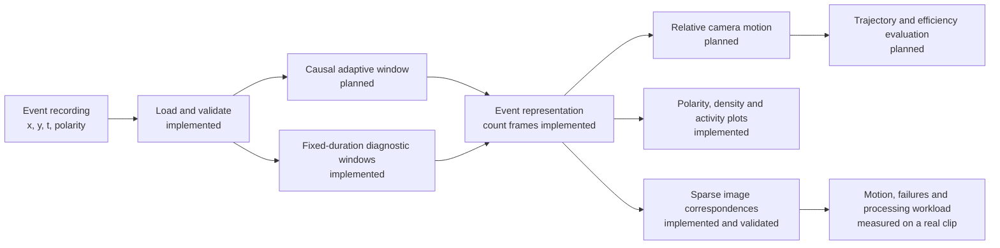
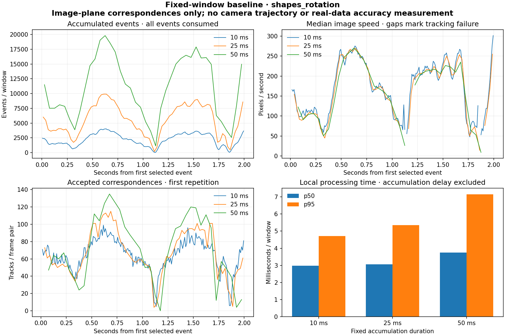

# Adaptive Event VO

**Research question:** Can a causal event-window controller use recent event density and motion activity to improve the accuracy–computation trade-off of monocular event-based visual odometry?

This repository is a small research framework under development. **Weeks 1–2 are implemented:** validated event ingestion, exhaustive fixed-window accumulation, sparse image-motion estimation, controlled displacement tests, and a reproducible run on real Zurich event data. Adaptive control, camera-pose estimation and trajectory evaluation are planned. No VO or energy improvement has been established.

## System architecture



The working path is **recording → validation → fixed windows → event frames → image correspondences → reports**. Image correspondences have not yet been converted into camera poses. The proposed controller and VO stages have no placeholder implementations.

## Quick start

Requires Python 3.10+; the Week 2 reference used Python 3.12.14, NumPy 2.3.5, OpenCV 4.14.0 and Matplotlib 3.10.8. No GPU or display server is needed. The synthetic commands work without a dataset download.

```bash
git clone https://github.com/aryaaupa/adaptive-event-vo.git
cd adaptive-event-vo
python -m venv .venv
source .venv/bin/activate
python -m pip install -e .
adaptive-event-vo demo --output-dir outputs/demo
```

The demo generates a seeded synthetic recording, **reloads it through the dataset loader**, and writes:

- `outputs/demo/synthetic_events.npz`: named event arrays, integer microsecond timestamps.
- `outputs/demo/event_stream.png`: asynchronous event raster, polarity occupancy, spatial density, temporal rate, and four adjacent accumulation windows.
- `outputs/demo/event_stream.json`: event counts, window bounds, input SHA-256, command, seed, and runtime versions.

Equivalent commands are `python -m adaptive_event_vo demo` and `python scripts/run_demo.py`. Run the tests with:

```bash
python -m unittest discover -s tests -v
```

To load the small committed recording:

```bash
adaptive-event-vo view examples/synthetic_events.csv \
  --width 32 --height 24 --timestamp-unit us \
  --start-ms 0 --window-ms 100 --output outputs/example.png
```

Use the same command with your own `.csv` or `.npz`, supplying its actual sensor dimensions and timestamp unit. The script equivalent is `python scripts/visualize_events.py ...`. See [dataset formats and validation](docs/datasets.md) before converting sensor data.

### Week 2 motion baseline

```bash
# Known image-displacement checks and a synthetic end-to-end baseline.
adaptive-event-vo validate-flow --output-dir outputs/flow_validation
adaptive-event-vo motion-demo --output-dir outputs/motion_demo

# Official real recording: approximately 157 MB, cached under ignored data/.
python scripts/download_data.py --start-s 5 --duration-s 2
adaptive-event-vo baseline data/davis/shapes_rotation_clip/events.npz \
  --manifest data/davis/shapes_rotation_clip/manifest.json \
  --config configs/fixed_window.json \
  --output-dir outputs/week2/shapes_rotation
```

The baseline saves `summary.json`, every window's measurements in `windows.csv`, accepted correspondences in `tracks.csv`, and `baseline.png`. [Week 2 methodology and reproduction](docs/week2.md) explains time references, confidence checks, failures, calibration metadata, data terms, and timing exclusions. The direct dependencies of the saved run are listed in [requirements-reference.txt](requirements-reference.txt).

## Current evidence


**Figure 1.** Generated by this repository's seeded synthetic demo. Blue denotes positive polarity, orange negative, and purple both polarities at the same pixel. The top-left raster displays at most 5,000 events; counts and other panels use every event. This is an ingestion/visualization fixture with no ground-truth camera poses, not a real-sensor experiment or evidence of odometry accuracy. See [the saved run summary](results/ingestion_demo.json) and [reproduction instructions](docs/experiments.md).



**Figure 2.** Actual Week 2 run on the UZH DAVIS `shapes_rotation` development clip, source interval `[5, 7)` s. All methods consume the same **437,670 events**. Gaps in image-speed estimates mark failed tracking gates. Calibration is recorded but not applied; no pose ground truth is used to score this image-motion run.

| Fixed window | Frames | Pairs passing ≥8-track gate | Events / repetition | Processing p50 / p95 (ms per window) | Median total processing (ms) |
| --- | ---: | ---: | ---: | ---: | ---: |
| 10 ms | 200 | 196 / 199 | 437,670 | 2.98 / 4.71 | 643.26 |
| 25 ms | 80 | 76 / 79 | 437,670 | 3.07 / 5.34 | 259.71 |
| 50 ms | 40 | 37 / 39 | 437,670 | 3.74 / 7.15 | 159.53 |

These are exploratory local processing measurements over three repetitions, with one OpenCV thread and OpenCL disabled. They include count-image construction and sparse LK tracking; loading, scheduling, warm-up, diagnostics, export, plotting and accumulation delay are excluded. Timing varies by host. Passing the correspondence gate is **not a motion-accuracy score**. [Machine-readable results](results/tables/shapes_rotation_baseline.json) record the full configuration, CPU, versions, hashes and failures; [artifact attribution](results/README.md) includes the dataset license.

The separate [known-translation validation](results/tables/flow_validation.json) passes all four image shifts with mean accepted-track endpoint errors below 0.001 px, plus explicit blank/textureless/disappearance failures. These repeat the same synthetic texture under ideal shifts; they validate the implementation, not real-sensor motion accuracy. See [the validation figure](results/figures/flow_validation.png).

Fixed event-count and adaptive schedules remain Week 3 work. ATE/RPE, estimated-versus-ground-truth trajectories, energy use and an accuracy–computation comparison remain unmeasured. They will be added only after geometric VO validation.

## Technical contribution and methodology

The **proposed algorithmic contribution** is a bounded, causal controller for event-window duration using recent event rate and motion activity. It will be compared with fixed-duration and fixed-count accumulation while holding the representation, motion estimator, calibration, and evaluation settings constant. [Methodology](docs/methodology.md) defines the candidate update, its units, failure cases, and ablations. It is a research hypothesis; novelty relative to prior work remains to be assessed.

The implemented foundation makes that comparison auditable:

- **Explicit event contracts:** named arrays, required units and sensor dimensions, timestamp-origin preservation, integer subtraction before float conversion, and rejection of malformed input rather than automatic sorting.
- **Lossless counting:** per-polarity integer event counts retain repeated events and avoid opposite-polarity cancellation. Temporal windows use `[start, end)` bounds with tests at exact boundaries.
- **Reproducible diagnostics:** a seeded fixture, headless figures, input hashes, environment metadata, and conservation checks for spatial and temporal event counts.
- **Auditable motion baseline:** exhaustive 10/25/50 ms schedules, declared frame reference times, forward/backward LK confidence checks, explicit failures and equal actual event workloads on a real development clip.

The NPZ/CSV loader reads converted recordings into memory. DAVIS clip conversion streams the selected archive prefix, but memory-budgeted online processing is future work. Camera intrinsics/distortion are parsed and recorded; distortion correction, time surfaces, raw ROS bag/AEDAT loading and pose estimation are outside this release. Synthetic fixtures are not physical event-camera simulators.

## Repository layout

```text
adaptive-event-vo/
├── pyproject.toml
├── src/adaptive_event_vo/
│   ├── cli.py
│   ├── datasets/          # CSV/NPZ loader and synthetic fixture
│   ├── representations/   # Per-polarity count frames and RGB occupancy
│   ├── motion/            # Fixed-scale tracking images and sparse LK
│   ├── evaluation/        # Baseline runs and known-displacement validation
│   └── visualization/     # Headless diagnostic report
├── configs/               # Shared fixed-window experiment configuration
├── scripts/               # Demo, DAVIS clip preparation and baseline wrappers
├── examples/              # Small synthetic CSV and format notes
├── tests/                 # Loader, representation and CLI integration tests
├── docs/                  # Data, methodology, experiments and roadmap
└── results/               # Selected reproducible artifacts only
```

New modules will be added when they work. Large datasets belong in ignored `data/`; temporary artifacts belong in ignored `outputs/`.

## Development roadmap

**8 of 24 tasks complete (Weeks 1 and 2: 4/4 each).** The [six-week tracker](docs/roadmap.md) includes concrete deliverables and gates for the remaining work. Six weeks is a target; calibration, correspondence estimation, and monocular scale ambiguity may extend the VO stage.

The next checkpoint is a causal adaptive controller with density/motion ablations. The first research checkpoint remains a reproducible VO accuracy–computation comparison against fixed policies.

## License

Code and the included synthetic fixtures are provided under the [MIT License](LICENSE). DAVIS data and derived artifacts retain their [separate attribution and license](results/README.md); external raw datasets are excluded from Git.
